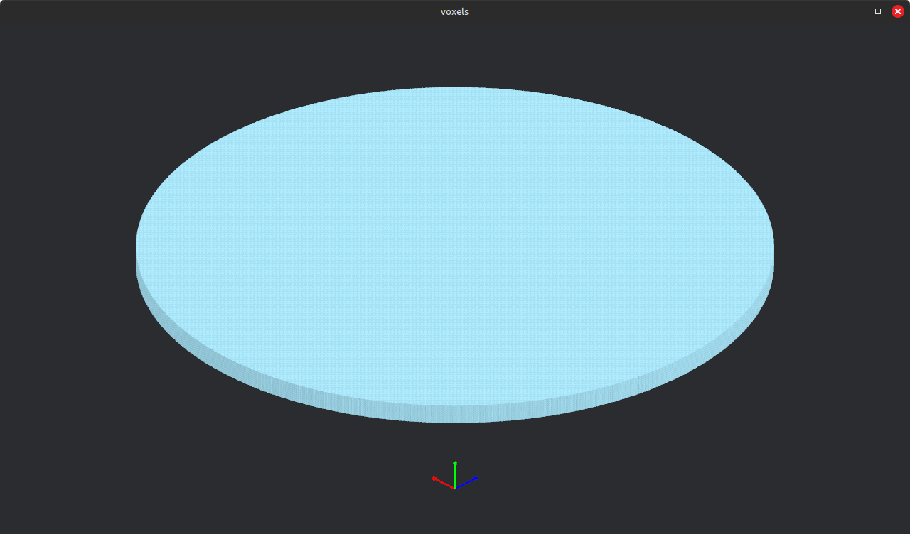
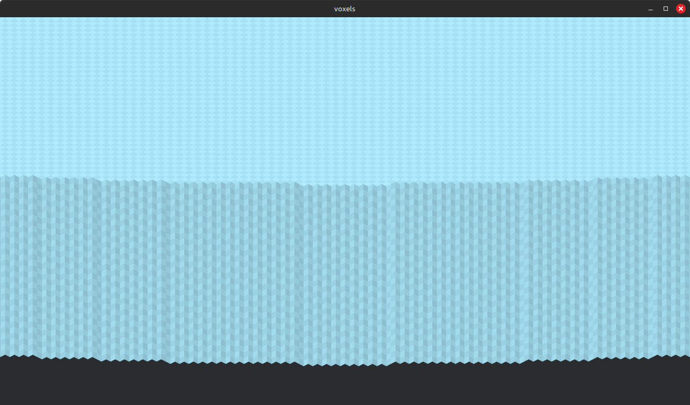
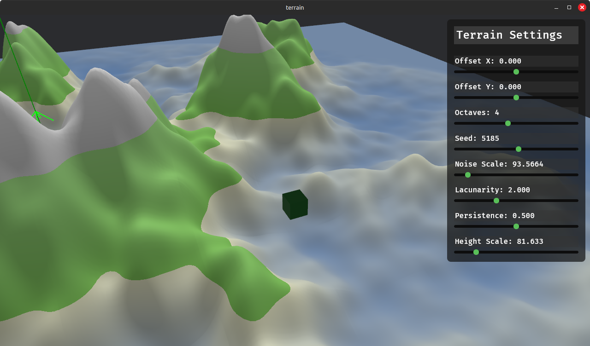
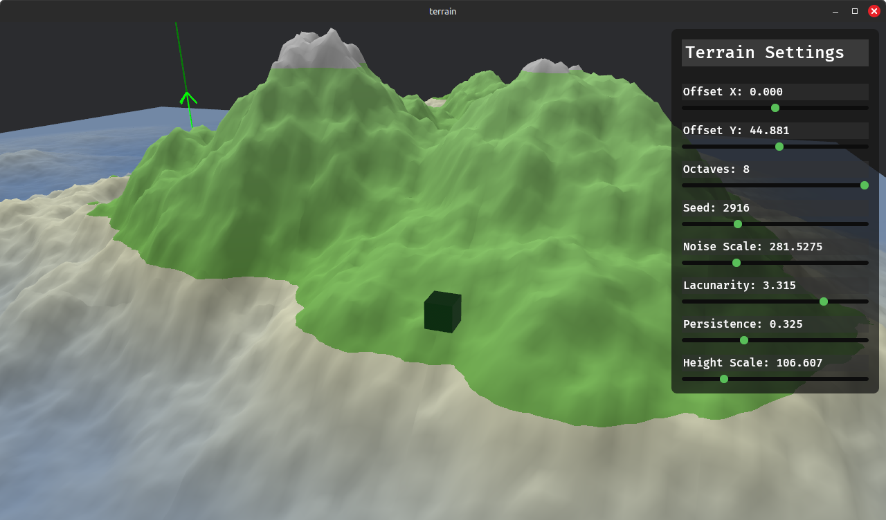

# Portfolio

Systems and graphics programming in Rust — GPU-driven rendering pipelines, a from-scratch physics engine, and a zero-copy serialization format. The common thread is performance: every project here is built around minimizing CPU overhead, draw calls, or copies, instead of reaching for the naive approach first.


---

## Projects

### [Voxel Engine](voxels/)

A custom voxel rendering engine on top of Bevy. Greedy meshing, instanced rendering, and `multi_draw_indirect` collapse an entire visible world into a single GPU draw call per frame — a circular platform of **~26.4 million voxels across ~800 chunks renders in one draw call**, with CPU overhead that's O(1) regardless of world size. Full 3D geometry is reconstructed from bit-packed instance data at vertex-shader time via a custom WGSL shader.

<p align="center">
  
  
</p>

**Tech:** Rust · Bevy · WGSL · multi-draw indirect · greedy meshing
**Read more:** [voxels/Readme.md](voxels/Readme.md)

---

### [Terrain Generator](terrain/)

A tile-based procedural terrain system for Bevy built around a multi-draw indirect render pipeline, a custom slot-map instance manager, and a double-buffered GPU upload system. Like the voxel engine, CPU draw call overhead is **O(1)** regardless of tile count — the render world is a strict one-directional consumer of noise and mesh data generated on the main world.

<p align="center">
  
  
</p>

**Tech:** Rust · Bevy · WGSL · multi-draw indirect · fractal noise
**Read more:** [terrain/readme.md](terrain/readme.md)

---

### [XPBD Physics Engine](xpbd/)

A real-time rigid body physics engine implementing **Extended Position-Based Dynamics** (Müller et al., SIGGRAPH 2020), with distance, hinge, servo, and mouse-driven grab constraints running on a sub-stepped solver fully decoupled from Bevy's render loop. Compiles natively or to WebAssembly via Trunk.

**[Live interactive demo →](https://beocoding.github.io/portfolio/xpbd/demo/)** — drag the bodies and watch the constraints solve in real time.

**Tech:** Rust · Bevy ECS · WebAssembly (WebGL2) · custom XPBD solver
**Read more:** [xpbd/README.md](xpbd/README.md)

---

### [Fluffr](fluffr/)

A bit-level, zero-copy serialization library in the spirit of FlatBuffers — except the schema *is* your Rust struct. A few derive macros replace the separate schema language and codegen step entirely, while an optional `#[derive(Row)]` columnar mode generates a struct-of-arrays registry for query-heavy workloads.

Benchmarked head-to-head against JSON, Protobuf, and FlatBuffers on an 11-field struct:

| Format     | Encode (ns) | Decode (ns) | Network Latency (ns) |
| ---------- | ----------- | ----------- | --------------------- |
| JSON       | 356.8       | 597.1       | 593.2                  |
| Protobuf   | **90.5**    | 240.7       | 236.7                  |
| FlatBuffers| 361.4       | 337.2       | 359.8                  |
| **Fluffr** | 167.7       | **4.97**    | **6.41**                |

Decode is ~70x faster than FlatBuffers and ~120x faster than JSON, with no parse step — views resolve field offsets directly against the raw buffer, touching only the fields actually read.

**Tech:** Rust · proc-macros · zero-copy views
**Read more:** [fluffr/README.md](fluffr/README.md)

---

## Tech Stack

- **Language:** Rust
- **Rendering:** [Bevy](https://bevyengine.org/) (ECS + render graph), custom WGSL shaders, GPU-driven multi-draw indirect pipelines
- **Simulation:** Custom XPBD constraint solver, decoupled from rendering via fixed-timestep ECS scheduling
- **Serialization:** Proc-macro-driven zero-copy binary formats (no codegen step, no schema language)
- **Web:** WebAssembly via `wasm-bindgen` / Trunk, WebGL2

## Repository Layout

Each project is an independent Cargo crate (its own `Cargo.lock`), not a shared workspace — clone the repo and build whichever one you want directly:

```bash
cd voxels && cargo run    # or: terrain, xpbd, fluffr
```

## License

All code in this repository is © Han, all rights reserved — shared here for portfolio/demonstration purposes. See individual `LICENSE` files within each project for specifics. Get in touch if you'd like to use any of it beyond that.
